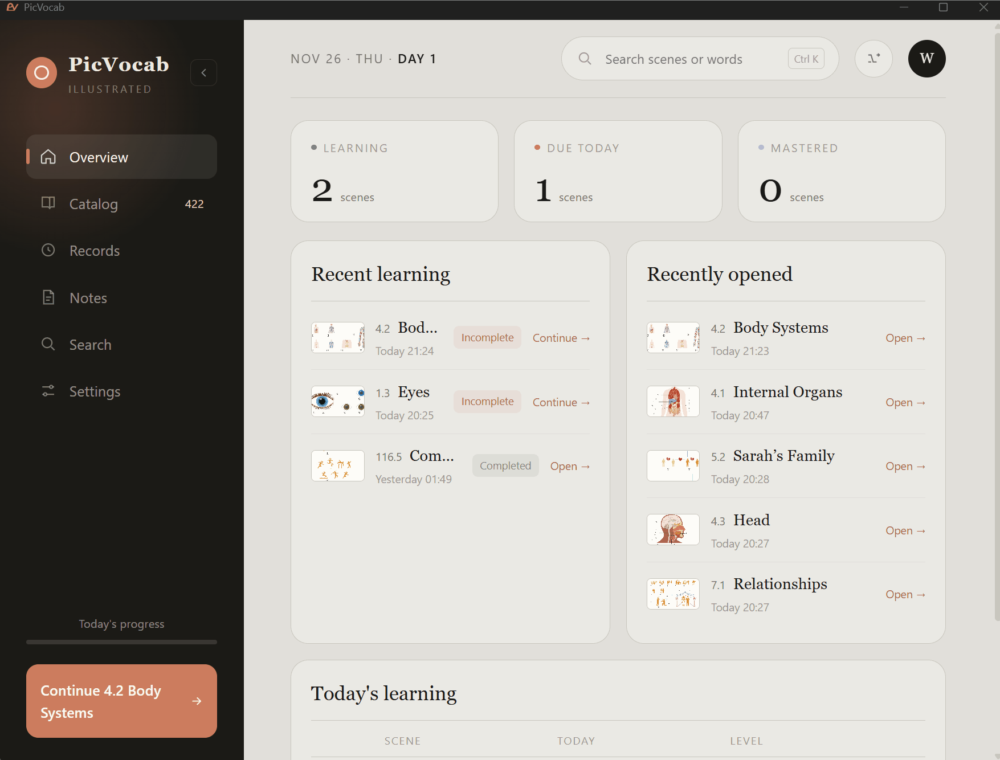
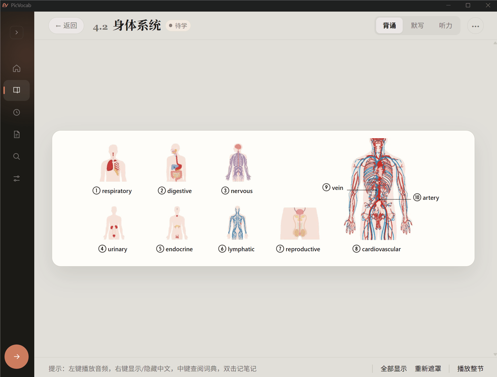
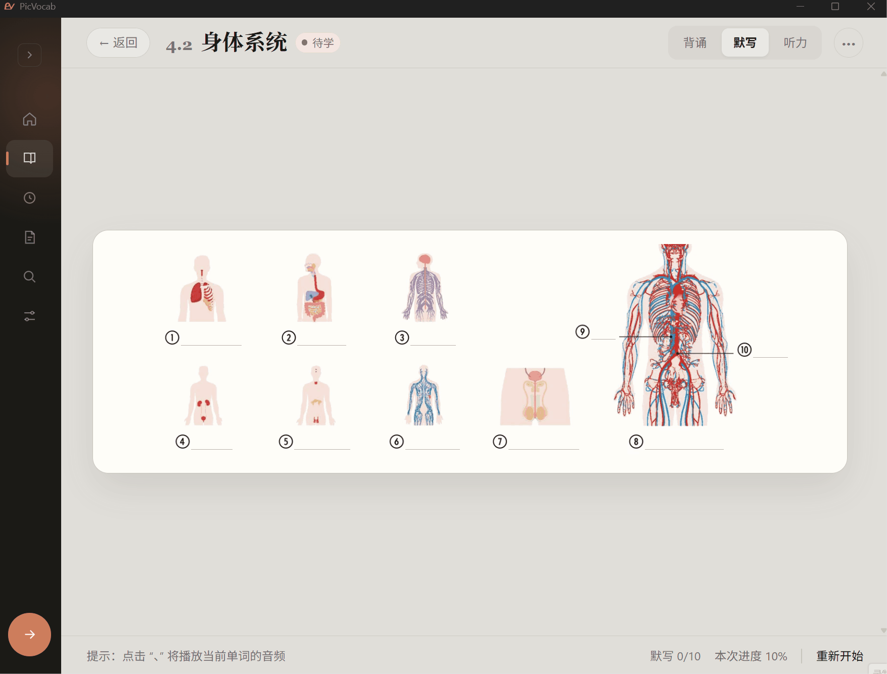
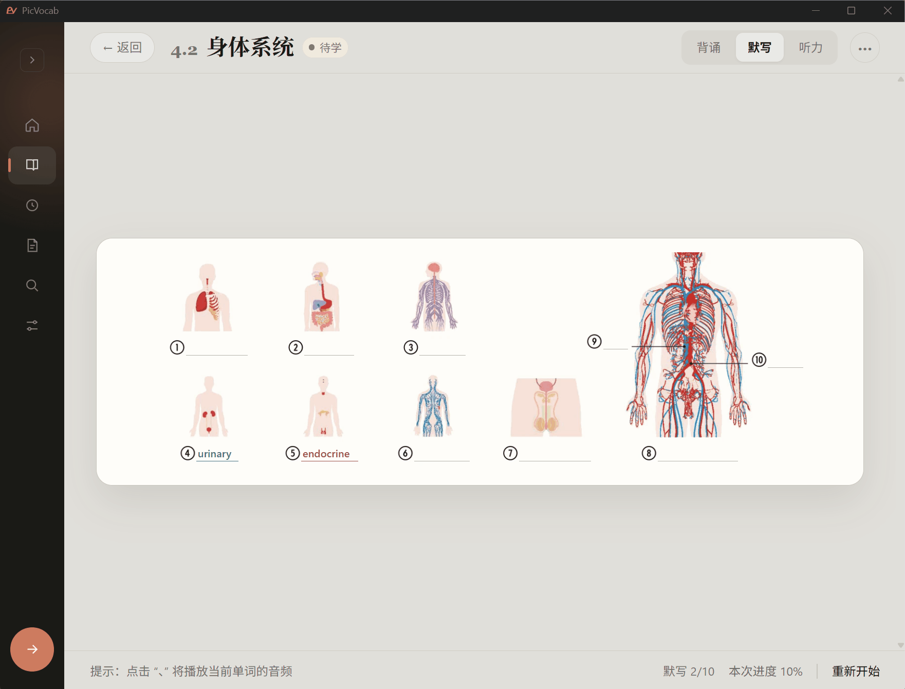
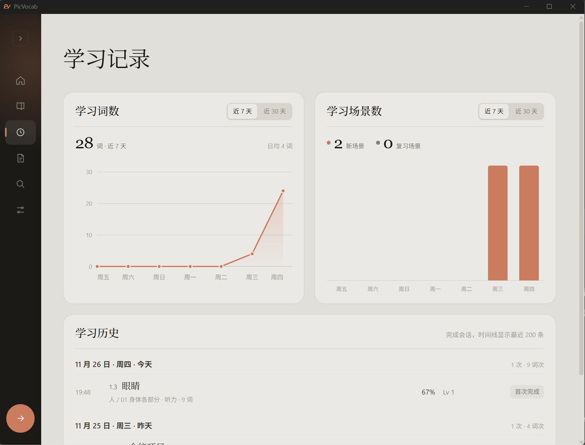
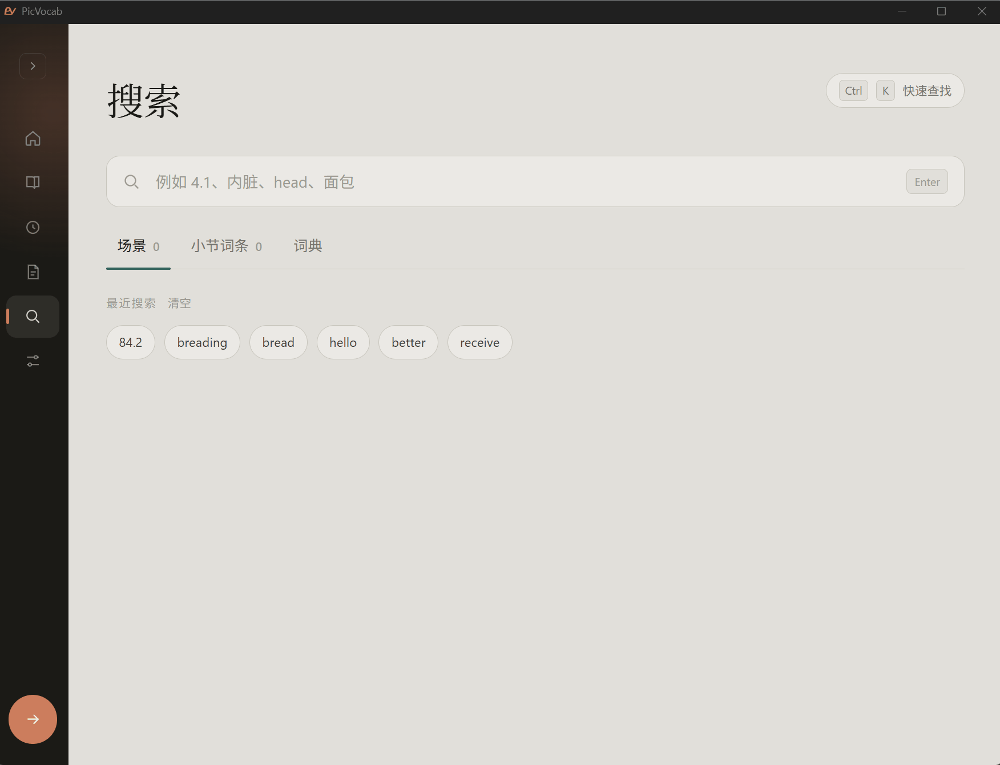

# PicVocab 使用指南

适用版本：0.1.0  
更新日期：2026-11-26

> 本指南对应 0.1.0。后续版本如界面有调整，以实际版本为准。

## 目录

## 首次启动与快速开始

### 启动应用

- 从桌面或开始菜单启动 PicVocab。
- 首次启动会创建本机学习数据库；学习记录、笔记与进度仅保存在本机。
- 如果尚未安装，请先按 README 中的系统要求与安装说明完成安装。

### 首次设置

首次使用软件时，请进行以下设置：

- （可选）选择或更换 `.mdx` 词典文件。导入格式、配套资源与更换步骤见[第 8 节「导入自定义词典」](#导入自定义词典)。
- （必须）按照自己的学习习惯来设置「学习与复习」。注意，保存设置后，当天所有未完成的学习记录会重置。

### 快速开始

可以从总览页的随机场景进入学习；也可以从目录进入场景学习。

## 三种学习模式

进入场景页后，可选择背诵、默写、听力三种模式。

### 通用操作

背诵模式下的操作同样适用于默写模式和听力模式。

- 左键播放音频
- 右键显隐中文
- 中键查阅词典
- 双击记录笔记
- esc 打开全屏

 

全屏窗口下：

- 按 `Esc` 进入或退出全屏。
- 使用 `Ctrl + 滚轮` 缩放，按 `Ctrl + 0` 恢复默认缩放。
- 滚轮、左键皆可移动画面。
- 支持触控板操作。

### 默写模式操作

以全屏后的操作为例：

- “、” 或点击序号可播放音频
- “=” 可提示单词
- “【” 或 “】” 可切换单词

 

注意：单词拼写正确后，会自动跳转到下一个单词；拼写错误并不计入错误；只有主动提示单词（“=”）后才会计入错误。

### 听力模式操作

软件将会随机播放单词。可点击“、”来重复播放音频，选择对应的图片即可。

### 词典窗口操作

词典窗口支持以下操作

- 顶部：后退/前进、双击快速查阅单词、词典内查找（`Ctrl + F`）、在新窗口打开词典、置顶
- 词典内部：双击选择单词跳转

 

## 复习与进度

学习日从每天 05:00 开始，到次日 05:00 结束。

### 小节状态

| 状态 | 含义 |
|---|---|
| 待学 | 尚未完成过一次完整学习 |
| 学习中 | 已完成过完整学习，复习级别为 1–4 级 |
| 已掌握 | 复习级别达到 5 级 |

### 复习级别

- 每个小节有 1–5 级复习级别，级别越高，下次复习间隔越长。
- 间隔依次为 1 / 3 / 7 / 15 / 30 天。
- 首次完成完整学习后进入 1 级；达到 5 级后状态变为「已掌握」。
- 完整学习结束后按正确率调整：
	- 达到设置中的「进入下一级」：复习级别前进一级；
	- 低于「退回上一级」：复习级别后退一级；
	- 介于两者之间：保持当前级别。

此外：

- 提前学习不改变复习级别和下次复习日期。
- 同一学习日内再次完成，可以按本次正确率再次调整级别。

## 搜索功能

### 命令面板

在任意页面，点击 `Ctrl+K` 即可打开命令面板，进行检索。

- 结果分为场景、词条、词典三组，`↑` / `↓` 移动，`Tab` 切换分组
- 词典结果按 `Enter`可在面板内查看释义；`Ctrl + Enter` 打开词典独立窗口。

### 搜索页

可通过 `↑` / `↓` / `←` / `→` 快速切换标签页、条目等。

词典搜索支持以下功能：

- 拼写纠正（如 recieve->receive）
- 通配符与正则（`*`匹配任意串，`?` 匹配单字符）
- 词性还原
- 中文反查

## 其它说明

### 侧边栏底部的快捷按钮

侧栏底部的快捷按钮根据最近一次打开的小节变化：

- 最近一次打开的小节尚未完成：显示「继续 <小节>」，点击直接回到该会话。
- 最近一次打开的小节已完成：显示「随机新场景」，点击从待学小节中随机打开一个。

### 总览页的卡片

「最近学习」与「最近打开」的区别：

- **最近学习**：最近实际填写过默写或进行过听力的小节，包含已完成与未完成；只打开未作答的小节不会进入此列表。
- **最近打开**：最近打开过的小节。

「今日学习」列出两类场景：

1. **今天已完成的场景**：新学的、在复习日前提前完成的、复习日完成的、逾期完成的、今日重学的。
2. **今天需要复习但尚未完成的场景**：
   - 今天到期：标注「今日待复习」；
   - 到期日早于今天：标注「逾期未学 N 天 · 到期 月/日」。

## 常见问题

### 能否只完成听力或只完成默写模式？

### 额外学习与提前学习？

### 如何导入词典

1. 准备文件：至少一个 `.mdx` 文件；如果有 `.mdd`，放在同一目录并使用与 `.mdx` 相同的主文件名；CSS、JS 等资源保持词典原有目录结构。
2. 打开「设置 → MDict 词典」，点击「选择词典」。
3. 选择 `.mdx` 文件；状态显示「已加载」和收录条数即表示加载成功。

常见限制：

- 中文反查取决于词典自身是否包含中文索引；没有中文索引的词典可能返回空结果，这不属于加载失败。
- 加密、特殊压缩或与 MDict 格式不兼容的文件可能无法加载；可尝试重新导出或换用其它 `.mdx`。
- `.mdd` 缺失时，词典中的图片、图标或例句音频可能不显示，但文字释义仍可查询。

### 如何更新

下载新版安装包覆盖安装即可，学习数据会保留；安装步骤见 README。当前版本不提供应用内自动更新。
